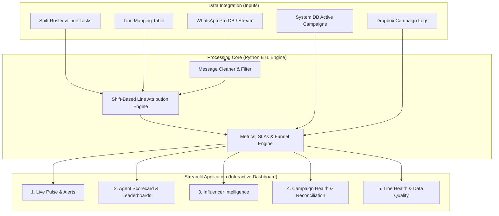

# Complete System Scope, Architecture & Deliverables

> **Document Version:** 2.0 (Comprehensive Master Scope)  
> **Status:** All historical requirements, metrics, and workflows captured and mapped to implementation modules.

---

## 🎯 System Objective & Overview

This system is an **Automated Intelligence & Operations Dashboard (Streamlit Web App + Python ETL Pipeline)** designed to unify all operational streams into a single source of truth:
1. **WhatsApp Pro Message Stream** (Live/Historical DB)
2. **Shift Roster & Line Tasks** (Google Spreadsheet via Service Account)
3. **Active Campaigns & Database Outcomes** (System Core DB)
4. **Manual Tracking & Audit Sheets** (Dropbox / Google Sheets)

---

## 📊 Comprehensive Deliverables Breakdown (Everything We Agreed On)

The final system consists of **3 Core Engines** and **5 Interactive Dashboard Modules** in Streamlit:

---

## 🧩 Detailed Modules & Features Matrix

### Module 1: Live Pulse & Operations Alerts (Real-Time View)
- [x] **Live Unanswered Alert Feed:** Shows all conversations where the influencer was the last sender (Dynamic Unanswered Rule) and how many minutes have passed.
- [x] **Live Shift Line Holders:** Shows which agent currently holds each of the 30 active WhatsApp lines based on the live shift roster.
- [x] **Urgent SLA Violations:** Highlights messages that exceeded the 15-minute / 60-minute response threshold.
- [x] **Daily Trend Tracker:** Real-time counter of total inbound messages, replies, and confirmations compared to daily targets.

---

### Module 2: Agent Performance & Leaderboards (The Operations Wing)
- [x] **Speed & SLA Compliance:**
  - Median reply time (overall and by shift: Morning, Between, Night).
  - % answered within 15 minutes, % answered within 60 minutes.
  - Performance during peak load (e.g., 16:00 rush).
- [x] **Unanswered Chat Attribution:**
  - Total unanswered bursts per agent during their shift hours.
  - Unanswered rate (% of assigned inbound chats left without a reply).
  - Handles all messages sent outside the platform (`original whatsapp` / AnyDesk) by attributing them to the line holder at that time.
- [x] **Role-Based Fair Evaluation:**
  - Automatic separation of **Inbox / Responders** (`Task == 'Live Response'`) vs. **Outreach / Pitchers** (`Task == 'Send Inv'`).
  - Outreach KPIs: Total invitations sent, reply rate (%), acceptance rate (%).
  - Inbox KPIs: Response speed, unanswered count, objection handling, conversion to "Yes".
- [x] **"After-Yes" Follow-Up & Logistics Quality:**
  - Tracks whether the agent sent logistics (location, brief, date confirmation) after an influencer confirmed.
  - Flags cases where an influencer said "Yes" but received no agent message within 24 hours.
- [x] **Persuasion & Message Quality Metrics:**
  - Template share (% of messages that are copy-pasted templates vs. customized/personal).
  - Linguistic effectiveness: Ending with questions vs. statements, closed questions vs. open questions.
  - Brand-adjusted scorecards (evaluating agents fairly regardless of whether they worked on an easy brand or a difficult brand).

---

### Module 3: Influencer Intelligence & Behavior (The Influencer Wing)
- [x] **Influencer Response Profiles:**
  - Fast responders vs. slow responders vs. non-responders.
  - Historical acceptance rate per influencer across campaigns.
- [x] **Ghosting & Flaker Tracking:**
  - Identifies influencers who accept invitations ("Yes / Confirmed") but fail to show up or complete coverage.
  - Cross-references WhatsApp "Yes" with System DB `visited` and `coverage` statuses.
- [x] **Country & Segment Analysis:**
  - Separate filtering and benchmarks for **KSA vs. Kuwait vs. UAE vs. Egypt**.
  - Tailored tracking for Kuwait campaigns to monitor lower response/acceptance dynamics.
- [x] **Searchable Influencer History:**
  - Lookup any influencer by phone or handle to see all historical chat threads, past campaigns, and reliability scores.

---

### Module 4: Campaign Health & Dropbox Reconciliation (The Management Wing)
- [x] **Campaign Funnel Progression:**
  - Visual funnel per active campaign: `Invited` ➔ `Replied` ➔ `Confirmed / Yes` ➔ `Logistics Sent` ➔ `Visited` ➔ `Coverage Posted`.
- [x] **Automated Dropbox vs. System Reconciliation:**
  - Automates the logic from `dropbox_vs_system_report.py`.
  - Compares confirmations in the System DB against manual Dropbox sheets.
  - Automatically flags discrepancies:
    - Influencers confirmed in Dropbox but missing in System.
    - Influencers visited but missing coverage links.
    - Campaigns missing target quotas.
- [x] **Campaign Cards & Quick Reply Reference:**
  - Built-in summary for each active campaign (dates, branches, coverage rules, compensation policy) to resolve top recurring questions (dates: 6,286, location: 3,078, content: 2,847, payment: 2,724).

---

### Module 5: Line Health, Infrastructure & Data Quality (Technical Wing)
- [x] **WhatsApp Lines Status Monitor:**
  - Live status of all company lines (Active, Banned, Mirrored, RDP, AnyDesk) integrated with the `NUMBERS Status` sheet.
- [x] **Data Quality & Anomaly Audit:**
  - Automatic filtering and isolation of WhatsApp group messages (18-digit IDs starting with `120`).
  - Filtering of internal test accounts (`trainee01`, `Developers Team`, `IT Team`).
  - Handling of NULL contacts and system change events.

---

## 📁 Source Code & Architecture Mapping

| Component | File Path | Status | Description |
|-----------|-----------|--------|-------------|
| **System Config** | `src/config.py` | Complete | Paths, shift hours, API settings, thresholds |
| **Data Connector** | `src/data_loader.py` | Complete | Safe loader for Google Sheets, WhatsApp CSV/DB, Line mappings |
| **ETL & Attribution** | `src/pipeline.py` | Next | Message cleaning, shift roster joining, line ownership logic |
| **KPI & Analytics** | `src/metrics.py` | Next | Calculation of reply times, unanswered rates, funnel metrics, lifts |
| **Streamlit UI** | `src/app.py` | Next | Multi-tab interactive web dashboard with filters and export buttons |
| **Background Sync** | `src/sync_jobs.py` | Next | Scheduled ingestion from DB replica and Dropbox API |

---

## 🔒 Security & Governance Constraints

1. **Google Sheets Access:** STRICT READ-ONLY via Service Account (active key: `operations-511207-c2981485761f.json`; auto-discovered by `src/config.py`).
2. **Database Access:** STRICT READ-ONLY (`SELECT` permissions only).
3. **Data Privacy (PII):** Phone numbers and personal details are masked in shared views and exports.
