# ⚡ WhatsApp Pro Operations & Multi-Source Reconciliation Engine

An enterprise-grade operational analytics, shift attribution, and multi-source audit intelligence system for WhatsApp Pro influencer campaign operations across **KSA, UAE, Kuwait, and Egypt**.

[](https://testing-whatsapp-gb9ktrrcuw7bqlpkden5gs.streamlit.app/)
[](https://www.python.org/downloads/)
[]()
[-success.svg)]()

🚀 **Live Production Dashboard:** [https://testing-whatsapp-gb9ktrrcuw7bqlpkden5gs.streamlit.app/](https://testing-whatsapp-gb9ktrrcuw7bqlpkden5gs.streamlit.app/)

> **Quick References & Supporting Docs:**
> - [PROJECT_STATUS.md](file:///c:/Users/DA-05/Downloads/Project/PROJECT_STATUS.md) — Comprehensive technical status, metric counts, and changelog.
> - [AGENTS.md](file:///c:/Users/DA-05/Downloads/Project/AGENTS.md) — Mandatory AI ground truth rules, operational constraints, and database policies.
> - [OPS_MANAGER_BRIEF.md](file:///c:/Users/DA-05/Downloads/Project/OPS_MANAGER_BRIEF.md) — Executive operational brief and management actions.
> - [OPERATIONS_RECOMMENDATIONS.md](file:///c:/Users/DA-05/Downloads/Project/OPERATIONS_RECOMMENDATIONS.md) — Detailed analytical findings & SLA optimization proposals.

---

## 📌 Executive Summary & Core Objectives

This engine bridges **four distinct operational data silos** into a unified real-time intelligence pipeline:

```mermaid
flowchart TD
    subgraph DataSilos["Operational Data Silos"]
        W[WhatsApp Pro Message Stream<br/>~50k raw messages]
        R[Google Sheets Roster<br/>Live Chat Shifts & Tasks]
        S[System Database<br/>Campaigns, Influencers & Bookings]
        D[Dropbox Client Workbooks<br/>50+ campaign files]
        P[pCloud Coverage Drive<br/>Raw media uploads]
    end

    subgraph CoreEngine["Core Processing & Reconciliation Pipeline"]
        PIPE[Roster Shift Attribution Engine<br/>src/pipeline.py]
        METRIC[Metrics & SLA Engine<br/>src/metrics.py]
        DROP_REC[Dropbox Reconciliation Engine<br/>src/reconciliation.py]
        PCLOUD_REC[pCloud Status 7 Audit Engine<br/>src/pcloud_reconciliation.py]
        CACHE[(Parquet Caching Layer<br/>data/cached_*.parquet)]
    end

    subgraph Presentation["Presentation & Operations Layer"]
        UI[Streamlit Executive Dashboard<br/>app.py / src/app.py]
        EXP[Operational Action Lists & CSV Exports<br/>Status 7 Gaps & Dropbox Discrepancies]
    end

    W --> PIPE
    R --> PIPE
    PIPE --> CACHE
    S --> METRIC
    CACHE --> METRIC
    D --> DROP_REC
    S --> DROP_REC
    P --> PCLOUD_REC
    S --> PCLOUD_REC
    DROP_REC --> CACHE
    PCLOUD_REC --> CACHE
    METRIC --> UI
    CACHE --> UI
    UI --> EXP
```



### Key Questions Answered by the Engine:
1. **Who sent the message?** Reassigns ~14.3k messages sent as `original whatsapp` to real logged agents based on shift rosters and WhatsApp line assignments.
2. **How responsive is the team?** Measures SLA reply times without artificial session dropouts, exposing true waiting time and unanswered chats.
3. **Did confirmed influencers post coverage?** Scans local pCloud media folders against System DB bookings to detect **Missing Status 7** operational gaps.
4. **Are client Dropbox sheets synced with System DB?** Audits differences between manual client lists and official DB bookings via dual-phone `Right(8)` normalization and handle matching.

---

## 🏗️ System Architecture & Core Modules

### 1. Roster Shift Attribution Engine (`src/pipeline.py`)
- **Live Chat Duty Exclusive:** Outbound messages sent as `original whatsapp` can **only** be attributed to agents whose shift task is explicitly Live Chat / Instant Response (`'live'`, `'response'`, `'sr.whatsapp'`). Non-chat tasks (Creation, Calling, Monitoring) are strictly excluded.
- **End-of-Shift Fallback:** When agents log `Start Time` but omit `End Time`, defaults to shift boundaries (Morning: 17:00, Between: 01:00 next day, Night: 09:00).
- **Strict Overlap Neutrality:** If 2 or more agents have overlapping Live Chat duties on the same line at the exact time of message dispatch, the message remains `original whatsapp` (no guessing, zero bias).
- **"All Lines Numbers" Fallback:** If no specific agent is assigned to a line, falls back to agents assigned to `All Lines Numbers`. If multiple agents are assigned, remains `original whatsapp`.
- **Date-Indexed O(1) Lookup:** Blazing fast attribution across 50,000+ messages in seconds.

### 2. pCloud Coverage vs. Status 7 Reconciliation Engine (`src/pcloud_reconciliation.py`)
- **System Active Campaigns as Driver:** The reconciliation is driven strictly from System Active Campaigns outwards (defined by `reference/active_campaigns.sql`), **not** by the raw directory structure of pCloud (~392 folders).
- **Multi-Layer Token Matching Hierarchy:**
  1. *Strict Country Guardrail:* Never match campaigns across different countries (KSA, UAE, KW, EGY).
  2. *Core Brand Token Sorting:* Cleans stopwords (`visit`, `delivery`, `highest platform`, etc.) and sorts tokens alphabetically (e.g., `Brand Oct KSA` == `KSA Brand Oct`).
  3. *Month & Year Alignment:* Prevents matching identical brands across different operational periods.
  4. *Jaccard Token Intersection & Fuzzy Matching:* Threshold >= 0.50 catches minor brand spelling variations.
- **Status 7 Ground Truth Audit:** Every influencer with coverage in pCloud **must** have `campaign_influencers.status_id = 7` (Posted / Completed Coverage). Any influencer present in pCloud with `status_id != 7` is flagged as an **Operational Gap (Missing Status 7)**.
- **Exportable Action List:** Generates actionable CSVs for operations teams to mass-update database statuses.

### 3. 3-Way Dropbox vs. System Reconciliation (`src/reconciliation.py`)
- **Dual-Phone Fallback (XLOOKUP Logic):** Queries primary phone first, falling back to WhatsApp number. Over 50% of active WhatsApp users have their number only in the second column.
- **Right(8) Phone Normalization:** Cleans all non-digits and extracts `clean_phone[-8:]`, neutralizing country codes (`+966`, `00966`, `966`, `+965`, `+20`) and formatting variations.
- **Social Handle Matching:** Normalizes and matches Instagram/TikTok handles against `influencers_master.csv`.
- **Gap Identification:** Surfaces influencers confirmed in manual client workbooks but missing official confirmation in System DB (`status = 1`).

### 4. Metrics & SLA Engine (`src/metrics.py`)
- **Ground Truth Active Definition:** An active / participating influencer is determined strictly from `campaign_influencers.status IN (2, 7, 8, 11, 13)`:
  - `2`: Visit (زار)
  - `7`: Posted / Coverage (عمل العملية كاملة ونزل التغطية)
  - `8`: Delivery (استلم دليفري)
  - `11`: Share (اتسجل إنه هيعمل الشير)
  - `13`: Post (اتسجل إنه هينزل بوست)
- **Strict Full-Duration Response Time (No Session Timeout / No Forgiveness):** Measures full duration from burst arrival to reply (`reply_time - burst_start_time`). Never artificially caps or forgives response times with a 24h reset; true customer waiting time is preserved.
- **Dynamic Unanswered Rule:** If an influencer was the last sender in a conversation, the chat is dynamically flagged as **Unanswered**.
- **Flakers & Missed Visits Audit:** Tracks influencers with Status `3` (Missed Visit), `9` (Missed Delivery), or `4` (Cancelled).

### 5. High-Performance Caching Layer (`data/cached_*.parquet`)
- Zero-latency reloads (<50ms) using fast binary Parquet storage:
  - `data/cached_whatsapp_tasks.parquet` & `data/cached_gc_tasks.parquet`
  - `data/cached_dropbox_recon_campaigns.parquet` & `data/cached_dropbox_recon_influencers.parquet`
  - `data/cached_pcloud_recon_campaigns.parquet` & `data/cached_pcloud_recon_influencers.parquet`

---

## 🖥️ Live Streamlit Dashboard Overview

The interactive dashboard (`app.py` / `src/app.py`) provides 5 comprehensive views:

| Tab | Name | Key Functionality |
| :---: | :--- | :--- |
| **Tab 1** | **🚨 Live Pulse & Alerts** | Real-time unanswered chats count, SLA breakdown (<15m, 15-60m, >60m), and message volume distributions. |
| **Tab 2** | **🏆 Agent Scorecards & KPIs** | Agent rankings by message volume, median reply speed, response time percentiles, and shift attribution badge. |
| **Tab 3** | **👥 Influencer Intelligence** | Official status breakdown, active influencer counts, and flakers/missed visits audit table with masked phones. |
| **Tab 4** | **🔄 Multi-Source Reconciliation** | **Sub-tab 1 (pCloud):** Active campaigns coverage audit, Status 7 gap detection, and 1-click CSV download.<br/>**Sub-tab 2 (Dropbox):** Target vs System vs Dropbox confirmation comparison and discrepancy audit. |
| **Tab 5** | **📱 Line Health & System Status** | Inventory of WhatsApp accounts (`whatsappAccId`), line nicknames, phone numbers, and operational readiness. |

**Sidebar Controls:**
- ⚡ **Force Reload / Clear Cache:** Instantly purges cache and reloads fresh data from parquet/disk.
- 🟢 **Live Status Indicators:** Real-time counts for active shifts, active agents, Dropbox gaps, and critical Status 7 gaps.

---

## ⚖️ Decided Business Rules & Operational Policies

These non-negotiable rules govern all codebase operations:

1. **Google Sheets Read-Only Policy:**
   - Spreadsheet Link: `https://docs.google.com/spreadsheets/d/1cmG2xWjcbF-76YOcvPKyn1x_BciElT3F3gyFemE_Kq0/edit`
   - Access via service account (`operations-511207-eb43144fc000.json`).
   - **STRICTLY READ-ONLY.** Under no circumstances should any script or agent write, modify, or append data to this spreadsheet.
2. **Local Storage Read-Only Policy:**
   - Dropbox (`C:\Users\DA-05\Dropbox\GC - operation live\Campaign Source\...`) is **STRICTLY READ-ONLY**.
   - pCloud (`P:\Operation - Head Office\Coverages-Final\...`) is **STRICTLY READ-ONLY**.
3. **Active Influencers Ground Truth:**
   - Always query `campaign_influencers.status IN (2, 7, 8, 11, 13)`. **Never** use `influencers.active`.
4. **Phone Normalization & Dual Fallback:**
   - Check `influencer_phone` first, fallback to `influencer_whats_number`.
   - Strip all non-digits and match by `clean[-8:]`.
5. **System DB as Driver:**
   - Always reconcile outward starting from System Active Campaigns (`reference/active_campaigns.sql`). Never use external folder counts as the truth source.
6. **Dynamic SQL Migration Preparedness:**
   - All modules accept DataFrames, decoupling business logic from file paths to guarantee zero downtime during live SQL database cutover.

---

## 📂 Project Structure

```
Project/
├── app.py                              # Root Streamlit entrypoint bridge
├── push_to_github.bat                  # One-click Git sync & cloud deployment script
├── README.md                           # Master system documentation (this file)
├── AGENTS.md                           # AI instructions, business rules & ground truth
├── PROJECT_STATUS.md                   # Operational status, metrics, and changelog
├── OPERATIONS_RECOMMENDATIONS.md       # Operational analysis & SLA improvement plan
├── OPS_MANAGER_BRIEF.md                # Operations Manager executive summary
├── COMPLETE_SYSTEM_SCOPE_AND_ROADMAP.md # Detailed deliverables & milestone roadmap
├── operations-511207-eb43144fc000.json # Google Sheets Service Account credentials (READ-ONLY)
│
├── src/                                # Core Engine Modules
│   ├── config.py                       # Configuration paths, status maps, shift definitions
│   ├── data_loader.py                  # Connectors for Sheets, CSVs, Parquet, and DB
│   ├── pipeline.py                     # Message cleaning, shift roster joining & attribution
│   ├── metrics.py                      # SLA reply times, unanswered flags, flakers audit
│   ├── reconciliation.py               # Dropbox 3-way reconciliation engine
│   ├── pcloud_reconciliation.py        # pCloud coverage audit & Status 7 gap detection
│   └── app.py                          # Streamlit application source
│
├── project/                            # Deployment Subfolder Compatibility
│   └── src/
│       └── app.py                      # Subfolder Streamlit forwarder
│
├── data/                               # Data Storage & High-Speed Cache Layer
│   ├── last_month_s_data.parquet       # WhatsApp message stream
│   ├── campaigns_since_1may.csv        # System campaigns dataset
│   ├── campaign_influencers.csv        # Influencer booking records
│   ├── influencers_master.csv          # Influencer profiles & social handles
│   ├── whatsapp_lines.xlsx             # Line ID to nickname mappings
│   ├── cached_whatsapp_tasks.parquet   # Cached WhatsApp shift tasks
│   ├── cached_gc_tasks.parquet         # Cached GC shift tasks
│   ├── cached_dropbox_recon_*.parquet  # Cached Dropbox reconciliation datasets
│   └── cached_pcloud_recon_*.parquet   # Cached pCloud reconciliation datasets
│
├── reference/                          # SQL Queries & Historical Scripts
│   ├── active_campaigns.sql            # Master query for Active Campaigns scope
│   ├── documentations for the database.xlsx # Official database status dictionary
│   └── dropbox_vs_system_report.py     # Legacy comparison script
│
└── scratch/                            # Diagnostic, testing & verification scripts
```

---

## 🚀 Getting Started & Execution

### Prerequisites
- Python 3.10 or higher
- Git installed and configured

### Installation
```bash
# Clone the repository
git clone https://github.com/trygcdata2-hub/testing-whatsapp.git
cd testing-whatsapp

# Install required dependencies
pip install -r requirements.txt
```

### Running the Dashboard Locally
```bash
# Launch Streamlit dashboard
streamlit run app.py
```
Or run directly from Python:
```bash
python -m streamlit run app.py --server.headless true --server.port 8501
```

Access the dashboard at `http://localhost:8501`.

### Syncing Updates with GitHub & Streamlit Cloud
To deploy updates to GitHub and refresh the live Streamlit Cloud production instance:
1. Double-click **`push_to_github.bat`** in the project root, OR
2. Run via terminal:
```bash
git add -A
git commit -m "feat: sync operational data and dashboard updates"
git push origin main
```
Streamlit Cloud automatically listens to GitHub commits on `main` and updates within ~60 seconds.

---

## 🛠️ Recent Fixes & Quality Assurance (v2.4)

- **NaN Safety in Status Mapping (`src/metrics.py`):** Added safe float conversion with try/except fallbacks to prevent runtime crashes when bookings contain missing status IDs.
- **Dynamic Flakers Column Handling (`src/metrics.py`, `app.py`, `src/app.py`, `project/src/app.py`):** Eliminated `KeyError` crashes when `booking_created_at` or `influencer_phone` are not present in source files.
- **Float-to-Int Key Resolution (`src/pcloud_reconciliation.py`):** Fixed dictionary key mismatches where numeric status IDs imported as floats prevented lookup in integer status dictionaries.
- **Code & UI Standardization:** Cleaned all legacy experimental artifacts and standardized code comments and UI components to pure English.
