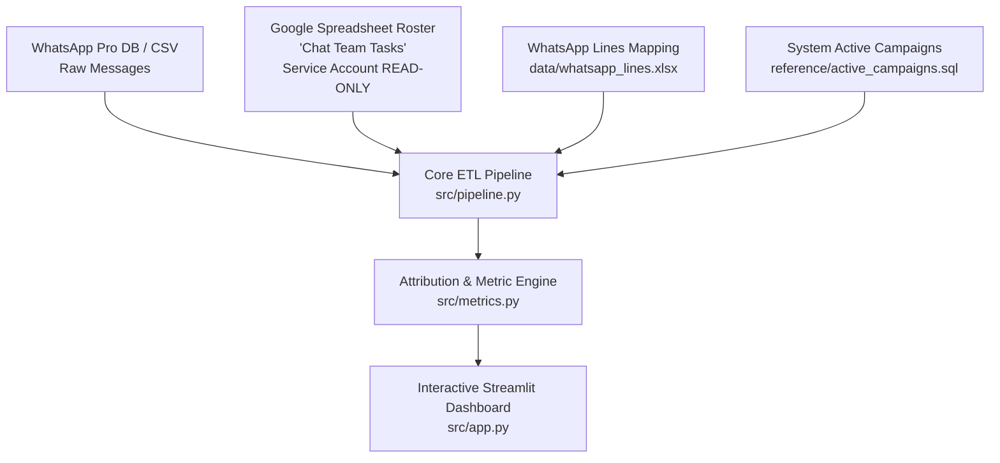

# WhatsApp Operations & Influencer Attribution Engine

### [Open the Live App](https://testing-whatsapp-gb9ktrrcuw7bqlpkden5gs.streamlit.app/)

An end-to-end data intelligence and operations monitoring system for WhatsApp Pro influencer campaign operations across KSA, Kuwait, UAE, and Egypt.

> **Detailed System Scope & Deliverables:** See [COMPLETE_SYSTEM_SCOPE_AND_ROADMAP.md](./COMPLETE_SYSTEM_SCOPE_AND_ROADMAP.md) for the full breakdown of all modules, metrics, and dashboards.


## 📌 Project Overview

This system tracks and evaluates:
1. **Agent Performance (KPIs & Leaderboards):**
   - Reply speed (median response time, % answered within 15m / 60m).
   - Dynamic Unanswered Tracking (pure dynamic rule: if influencer sent the last message, chat is unanswered).
   - Role-based separation: Inbox / Responders vs. Outreach / Invitations.
   - "After-Yes" funnel tracking (did the agent send logistics/brief after confirmation?).
2. **Influencer Tracking:**
   - Response speed, acceptance rates, attendance vs. ghosting.
3. **Campaign Attribution & Real-Time Sync:**
   - Correlating WhatsApp conversations with System Database campaign outcomes and Dropbox sheets.

---

## 🏗️ System Architecture & Data Sources



### Data Sources Index:
1. **WhatsApp Messages (`data/last_month_s_data.csv` / DB):**
   - Tables: `Message`, `Room`, `Contact`, `Whatsapp`.
   - Contains message timestamps, sender status (`isFromMe`), text content, line ID (`whatsappAccId`), and logged-in user (`userName`).
2. **Shift Roster & Tasks (Google Spreadsheet):**
   - **Link:** `https://docs.google.com/spreadsheets/d/1cmG2xWjcbF-76YOcvPKyn1x_BciElT3F3gyFemE_Kq0/edit`
   - **Credentials:** `operations-511207-eb43144fc000.json` (**STRICTLY READ-ONLY**).
   - Key Sheets: `what's app tasks`, `Tasks ( GC )`, `NUMBERS Status`.
   - Provides: Agent Name, Shift, Task Role (`Live Response` vs `Send Inv`), Line Nickname, Start Time, End Time.
3. **Line Mappings (`data/whatsapp_lines.xlsx`):**
   - Maps database `whatsappAccId` to line nicknames (e.g. `146` ➔ `ELITE-KSA`, `127` ➔ `Egypt`).
4. **Active Campaigns (`reference/active_campaigns.sql`):**
   - System DB query for daily active campaign targets, confirmations, visits, and coverage.

---

## ⚖️ Decided Business Rules (Ground Truth)

Any AI model or developer continuing work on this codebase MUST strictly adhere to these rules:

1. **The Dynamic Unanswered Rule:**
   - The company must always be the last sender in a chat.
   - If the influencer sent the last message and no reply came, the chat is dynamically flagged as **Unanswered**, regardless of what the message was about (no keyword exceptions).
2. **Shift-Based Message Ownership:**
   - Every inbound message is owned by the agent holding that WhatsApp line (`whatsappAccId`) at the exact timestamp the message arrived.
   - Resolves all 23,657 messages sent outside the platform (`userName == 'original whatsapp'`).
3. **"All Lines Numbers" Rule:**
   - When an agent is assigned `All Lines Numbers` in their shift task, they are responsible for all lines during that time window, unless another agent has a specific line assigned.
4. **Shift End Fallback:**
   - If an agent logs a `Start Time` in the task roster but leaves `End Time` empty, the system automatically defaults the end time to the end of their respective shift (`Morning`, `Between`, `Night`).
5. **Google Sheets Read-Only Policy:**
   - Under NO circumstances should any script or agent write to, edit, or modify the Google Spreadsheet.

---

## 📂 Project Structure

```
Project/
├── README.md                           # Master system documentation (this file)
├── AGENTS.md                           # Strict AI rules & read-only constraints
├── OPERATIONS_RECOMMENDATIONS.md       # Full background analysis & recommendations
├── OPS_MANAGER_BRIEF.md                # Actionable brief for the Operations Manager
├── PROJECT_HANDOFF.md                  # Technical handover and DB schemas
├── Funnel_Verification_Samples.xlsx    # 90 sample conversations for funnel verification
├── operations-511207-eb43144fc000.json # Google Service Account credentials
├── data/
│   ├── last_month_s_data.csv           # 1-month raw WhatsApp message dump
│   └── whatsapp_lines.xlsx             # Mapping: whatsappAccId <-> line_name <-> phone
├── reference/
│   ├── active_campaigns.sql            # SQL query for active campaign outcomes
│   ├── dropbox_vs_system_report.py     # Comparison script for Dropbox vs. System
│   └── analysis_pipeline/              # Original pandas analysis scripts
├── src/                                # Core Application & Pipeline
│   ├── __init__.py
│   ├── config.py                       # Paths, shift hours, and constants
│   ├── data_loader.py                  # Connectors for Sheets, CSV/DB, and Lines
│   ├── pipeline.py                     # Message cleaning, attribution & shift joining
│   ├── metrics.py                      # Reply times, unanswered rates, funnel metrics
│   └── app.py                          # Streamlit Interactive Web Application
└── scratch/                            # Diagnostic, exploration, and test scripts
```

---

## 🚀 Execution & Next Steps

### 1. What is Completed:
- [x] Full operational & exploratory data analysis (EDA) on raw WhatsApp stream.
- [x] Extraction and verification of 90 "After-Yes" sample conversations.
- [x] Connection to Google Spreadsheet via Service Account (Read-Only).
- [x] Extraction of WhatsApp line mapping (`data/whatsapp_lines.xlsx`).
- [x] Formalization of shift fallback and line ownership rules.

### 2. Next Implementation Tasks:
1. **ETL Pipeline (`src/pipeline.py`):**
   - Merge `data/last_month_s_data.csv` with Google Sheet shift tasks using `data/whatsapp_lines.xlsx`.
   - Calculate response events, unanswered bursts, and agent performance metrics.
2. **Streamlit Application (`src/app.py`):**
   - Build real-time filters (by Agent, Campaign, Line, Date, Shift).
   - Display Agent Leaderboards (Speed, Unanswered %, Conversion).
   - Display Influencer Behavior (Top Responders, Fast Acceptors, Flakers).
